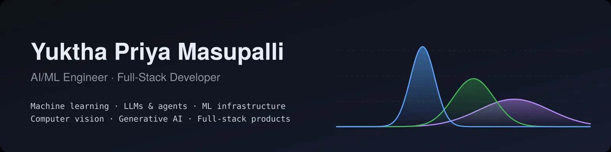
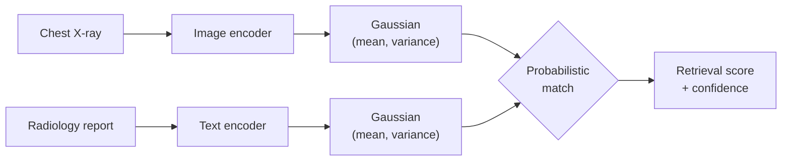
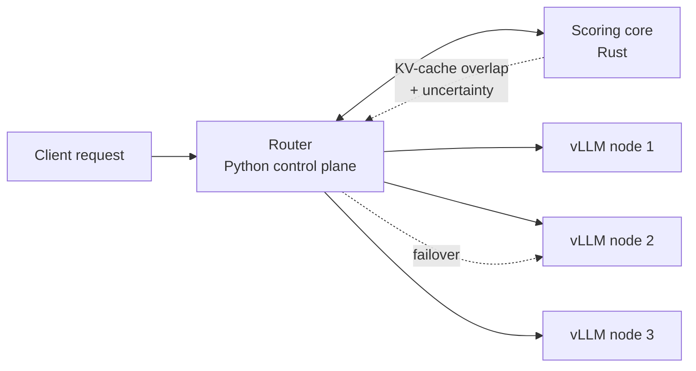

<!--  -->

## Hi, I'm Yuktha

I'm an AI/ML engineer and full-stack developer. I like owning the whole thing: training the model, building the service around it, and shipping the interface people use.

**What I work on**

- **Machine learning and computer vision.** Vision-language models, contrastive learning, representation learning, and model evaluation. My research on reliable medical image retrieval is published at WACV 2026, IEEE BigData 2024, and an AAAI 2025 workshop.
- **LLMs and agents.** Multi-agent pipelines, structured LLM outputs, retrieval over documents, and LLM-powered product features.
- **ML infrastructure.** Inference serving with vLLM, request routing, containerized deployment, and Rust for performance-critical code.
- **Generative AI.** Diffusion-based image generation and virtual try-on, served behind fault-tolerant APIs.
- **Full-stack engineering.** 2+ years shipping customer-facing Angular apps in industry, plus REST and real-time backends in Node.js and Flask.

M.S. Computer Science, Texas A&M University–San Antonio. Open to ML Engineer, AI Engineer, Applied Scientist, and Full-Stack roles.

[Email](mailto:myukthapriya@gmail.com) · [LinkedIn](https://linkedin.com/in/yukthapriya) · [Google Scholar](https://scholar.google.com/citations?user=UkX-bOYAAAAJ) · [ResearchGate](https://www.researchgate.net/profile/Yuktha-Priya-Masupalli)

---

## What I've built

### [MedProbCLIP](https://github.com/yukthapriya/REPO_NAME): retrieval that knows when it's unsure
Python · PyTorch · MIMIC-CXR · WACV 2026

Standard CLIP maps every X-ray and report to a single point, so it can't say "I'm not confident about this match." MedProbCLIP represents each one as a Gaussian instead. The spread of the distribution carries the uncertainty, which gives better-calibrated retrieval and more stable behavior when inputs are noisy or shifted. Trained on MIMIC-CXR.

### [KV-cache aware router for vLLM](https://github.com/yukthapriya/REPO_NAME)
Python · Rust · vLLM

When you run several vLLM nodes, sending a request to the node that already has its prefix cached saves real compute. This router scores nodes on KV-cache overlap and an uncertainty signal, with the scoring written in Rust so it stays off the latency budget. It includes `kv_aware`, `least_loaded`, and `round_robin` strategies for comparison, automatic failover, and per-request routing metrics.

### [ARIA](https://github.com/yukthapriya/REPO_NAME): a research team made of agents
Python · LLMs · Multi-agent

Six agents (Reader, Hypothesis, Experiment, Debate, Synthesis, Report) take a research question from papers to a written report. The Debate agent exists because single-agent pipelines tend to agree with themselves; it pushes back on hypotheses before they reach the report. Handles PDF ingestion, arXiv search, and citation graphs.

### [Cloré](https://github.com/yukthapriya/REPO_NAME): AI stylist with virtual try-on
Python · LLMs · Diffusion · Full-stack

Suggests outfits from your own wardrobe and shows them on you. An LLM on Groq returns structured JSON for outfit reasoning, and IDM-VTON handles try-on from a separate inference server. Fallback endpoints and a local try-on path keep it working when a model service is down.

### [InterviewFlow](https://github.com/yukthapriya/REPO_NAME): live coding interviews
Node.js · Socket.io · Docker · Nginx

Shared Monaco editor synced in real time, JWT auth, saved sessions, chat, and pluggable code execution through Piston or Judge0. Containerized behind Nginx.

---

## Publications

- **MedProbCLIP: Probabilistic Adaptation of Vision-Language Foundation Model for Reliable Radiograph-Report Retrieval** · WACV 2026
- **Uncertainty-Aware Vision–Language Learning Improves Chest X-Ray Retrieval** · IEEE Pulse 2026
- **[Benchmarking Robustness of Contrastive Learning Models for Medical Image-Report Retrieval](https://link.springer.com/chapter/10.1007/978-3-032-11999-5_15)** · AAAI 2025 Workshop, Springer 2026
- **Probabilistic Embedding for Enhancing Medical Imaging Model Trustworthiness Through Calibration via Gaussian Distribution** · 2025, first author
- **Improving Medical Imaging Model Calibration through Probabilistic Embedding** · IEEE BigData 2024

---

## What I work with

   
  

Also: Hugging Face, vLLM, RxJS, Socket.io

---

## Activity

---

If you're building something with ML, LLMs, or a product that needs both, I'd like to hear about it. Email is the fastest way to reach me.
